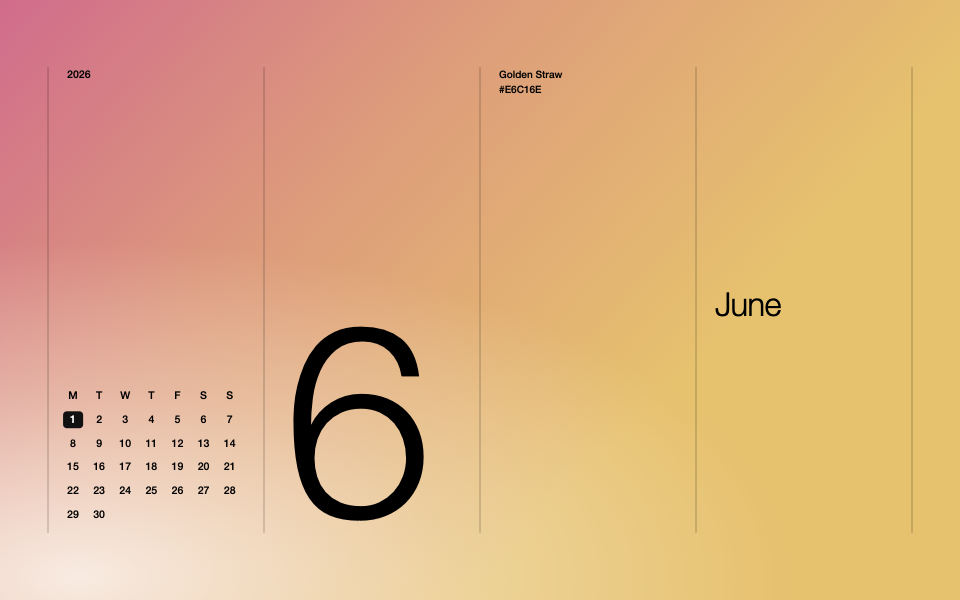

# Monthly Native

A free, open-source macOS app that turns your desktop into a monthly calendar. Choose your own colours, show today's events, and switch between saved wallpaper designs on a schedule.

**[Website](https://mrirgashev.github.io/monthly/)** · **[Download for Mac](https://github.com/mrirgashev/monthly/releases/latest/download/MonthlyNative.dmg)** · [All releases](https://github.com/mrirgashev/monthly/releases) · [Build from source](Docs/BUILDING.md) · [Report a bug](https://github.com/mrirgashev/monthly/issues)



*Wallpaper rendered by the app. Colours, layout, calendar and large numeral are customizable.*

## Install

Requires **macOS 14 Sonoma or later**. The download includes Apple Silicon and Intel binaries; Intel runtime compatibility has not yet been verified on hardware.

1. Download **MonthlyNative.dmg** using the link above.
2. Open it and drag **Monthly Native** into **Applications**.
3. Open Monthly Native from Applications, choose a design, and click **Apply**.

The release is ad-hoc signed, **not Developer ID signed or notarized**. macOS may block a downloaded copy. If you trust this project, follow [Apple's instructions for opening an app from an unidentified developer](https://support.apple.com/en-us/102445), or [build it yourself](Docs/BUILDING.md). Do not disable macOS security protections.

The ZIP is an alternative app download. GitHub's “Source code” archives are for developers, not installers. No account, subscription, Python or other app is needed to run Monthly Native.

## What it does

- Custom solid colours, two-colour gradients, **24 gradient presets**, and seasonal monthly palettes.
- Designed, centred and right-aligned layouts with a month or day numeral, a Monday-first calendar and today's highlight.
- Saved designs that change at exact daily times, every hour, or every day—in your chosen order, without random shuffling.
- Optional events from macOS Calendar, including Google calendars added through Internet Accounts.
- Per-display wallpapers, Retina rendering, PNG export, menu-bar controls and optional launch at login.
- Settings inside the main window, plus a desktop control dot you can hide immediately.

Built with Swift, SwiftUI, AppKit and Core Graphics. No web engine, third-party runtime dependencies, tracking or network requests.

## Use it

**Choose an appearance.** Pick a layout and numeral. Under Background colour, use Presets, Custom, or By month. Custom colours stay fixed while the dates keep updating. Preview changes become live when you click **Apply**. Inspecting another month only changes the preview; Apply uses the current local date.

**Schedule designs.** Save the preview as a design, then choose Daily times, Every hour, or Every day. Set the times or arrange the cycle order, then Apply. Daily times repeat at your selected local clock times; hourly cycles use 60 elapsed minutes. Daily cycles follow local time across daylight saving changes. Missed changes during sleep are caught up after wake. A menu-bar appearance change pauses the design cycle; your saved designs remain available.

**Keep dates current.** Leave automatic updates enabled in Settings. Closing the window keeps the app running in the menu bar. **Command-Q quits it and stops automatic updates**; the last wallpaper remains. Enable Launch at login to start it when you sign in.

**Hide the dot.** Open Settings (Command-comma), then turn off Show desktop control dot. This takes effect immediately for every design, without Apply. The menu-bar controls remain available.

**Show events.** In Settings, click Connect Calendars and grant the macOS Calendar permission, then choose calendars. Return to the editor, choose the schedule display mode and Apply. For Google calendars, first add the account in System Settings → Internet Accounts. The app reads events; it never edits them.

## Privacy and limitations

Calendar access is optional. Event titles can appear on your desktop, in exported images, and in locally cached wallpaper PNGs. Nothing is uploaded. See [data storage and privacy](Docs/PRIVACY.md).

macOS wallpaper APIs affect the current Space on each display. The app refreshes visited Spaces while running; it cannot update every inactive Space atomically, or control the lock/login screen. Sleep delays updates until wake.

The app has been tested on an Apple Silicon Mac. External-display hardware, Intel execution, older supported macOS versions, login execution and all Calendar permission paths still need wider testing. See [validation details](Docs/VALIDATION.md).

## Development

```sh
git clone https://github.com/mrirgashev/monthly.git
cd monthly
./scripts/test.sh
open ".build/distribution/Monthly Native.app"
```

Requires macOS with Xcode 15+ / Swift 5.9+ or compatible Command Line Tools. See [building and packaging](Docs/BUILDING.md), [architecture](Docs/ARCHITECTURE.md), and [contributing](CONTRIBUTING.md).

## License and credits

[MIT License](LICENSE)—you may use, modify and redistribute the code, including commercially, under its terms.

An independent implementation inspired by [Living Monthly Wallpapers](https://monthlywallpapers.com/). Not affiliated with or endorsed by BetterCreating. It does not include their account or subscription services. No reference website code, marketing images, logos or font files are bundled. See [third-party notices](THIRD_PARTY_NOTICES.md).
